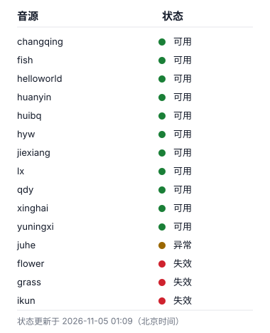
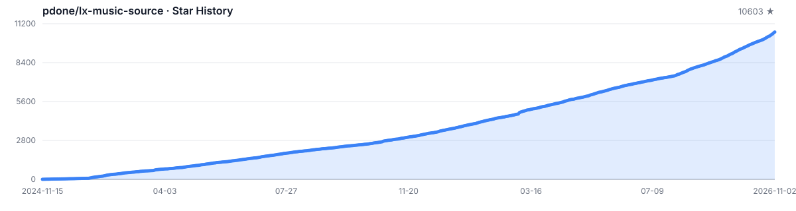

# lx-music-source
洛雪音乐源，内容源于网络

## 在线导入

> [!TIP]
> 每种音源包含两个链接，第一个是GitHub原始链接，第二个是加速链接（供访问 GitHub 受限的用户使用）。

<a id="changqing"></a>
### ChangQing

```
https://raw.githubusercontent.com/pdone/lx-music-source/main/changqing/latest.js
```

```
https://gh-proxy.org/raw.githubusercontent.com/pdone/lx-music-source/main/changqing/latest.js
```

<a id="feichangdao"></a>
### FeiChangDao

```
https://raw.githubusercontent.com/pdone/lx-music-source/main/feichangdao/latest.js
```

```
https://gh-proxy.org/raw.githubusercontent.com/pdone/lx-music-source/main/feichangdao/latest.js
```

<a id="fish"></a>
### Fish

```
https://raw.githubusercontent.com/pdone/lx-music-source/main/fish/latest.js
```

```
https://gh-proxy.org/raw.githubusercontent.com/pdone/lx-music-source/main/fish/latest.js
```

<a id="flower"></a>
### Flower

```
https://raw.githubusercontent.com/pdone/lx-music-source/main/flower/latest.js
```

```
https://gh-proxy.org/raw.githubusercontent.com/pdone/lx-music-source/main/flower/latest.js
```

<a id="grass"></a>
### Grass

```
https://raw.githubusercontent.com/pdone/lx-music-source/main/grass/latest.js
```

```
https://gh-proxy.org/raw.githubusercontent.com/pdone/lx-music-source/main/grass/latest.js
```

<a id="helloworld"></a>
### HelloWorld

```
https://raw.githubusercontent.com/pdone/lx-music-source/main/helloworld/latest.js
```

```
https://gh-proxy.org/raw.githubusercontent.com/pdone/lx-music-source/main/helloworld/latest.js
```

<a id="huanyin"></a>
### HuanYin

```
https://raw.githubusercontent.com/pdone/lx-music-source/main/huanyin/latest.js
```

```
https://gh-proxy.org/raw.githubusercontent.com/pdone/lx-music-source/main/huanyin/latest.js
```

<a id="huibq"></a>
### Huibq

```
https://raw.githubusercontent.com/pdone/lx-music-source/main/huibq/latest.js
```

```
https://gh-proxy.org/raw.githubusercontent.com/pdone/lx-music-source/main/huibq/latest.js
```

<a id="hyw"></a>
### HYW

```
https://raw.githubusercontent.com/pdone/lx-music-source/main/hyw/latest.js
```

```
https://gh-proxy.org/raw.githubusercontent.com/pdone/lx-music-source/main/hyw/latest.js
```

<a id="ikun"></a>
### ikun

```
https://raw.githubusercontent.com/pdone/lx-music-source/main/ikun/latest.js
```

```
https://gh-proxy.org/raw.githubusercontent.com/pdone/lx-music-source/main/ikun/latest.js
```

<a id="jiexiang"></a>
### JieXiang

```
https://raw.githubusercontent.com/pdone/lx-music-source/main/jiexiang/latest.js
```

```
https://gh-proxy.org/raw.githubusercontent.com/pdone/lx-music-source/main/jiexiang/latest.js
```

<a id="juhe"></a>
### JuheApi

```
https://raw.githubusercontent.com/pdone/lx-music-source/main/juhe/latest.js
```

```
https://gh-proxy.org/raw.githubusercontent.com/pdone/lx-music-source/main/juhe/latest.js
```

<a id="lx"></a>
### LX

```
https://raw.githubusercontent.com/pdone/lx-music-source/main/lx/latest.js
```

```
https://gh-proxy.org/raw.githubusercontent.com/pdone/lx-music-source/main/lx/latest.js
```

<a id="qdy"></a>
### QDY

```
https://raw.githubusercontent.com/pdone/lx-music-source/main/qdy/latest.js
```

```
https://gh-proxy.org/raw.githubusercontent.com/pdone/lx-music-source/main/qdy/latest.js
```

<a id="qingliang"></a>
### QingLiang

```
https://raw.githubusercontent.com/pdone/lx-music-source/main/qingliang/latest.js
```

```
https://gh-proxy.org/raw.githubusercontent.com/pdone/lx-music-source/main/qingliang/latest.js
```

<a id="sixyin"></a>
### SixYin

```
https://raw.githubusercontent.com/pdone/lx-music-source/main/sixyin/latest.js
```

```
https://gh-proxy.org/raw.githubusercontent.com/pdone/lx-music-source/main/sixyin/latest.js
```

<a id="suyin"></a>
### SuYin

```
https://raw.githubusercontent.com/pdone/lx-music-source/main/suyin/latest.js
```

```
https://gh-proxy.org/raw.githubusercontent.com/pdone/lx-music-source/main/suyin/latest.js
```

<a id="xinghai"></a>
### XingHai

```
https://raw.githubusercontent.com/pdone/lx-music-source/main/xinghai/latest.js
```

```
https://gh-proxy.org/raw.githubusercontent.com/pdone/lx-music-source/main/xinghai/latest.js
```

<a id="xinglan"></a>
### XingLan

```
https://raw.githubusercontent.com/pdone/lx-music-source/main/xinglan/latest.js
```

```
https://gh-proxy.org/raw.githubusercontent.com/pdone/lx-music-source/main/xinglan/latest.js
```

<a id="yuningxi"></a>
### YuNingXi

```
https://raw.githubusercontent.com/pdone/lx-music-source/main/yuningxi/latest.js
```

```
https://gh-proxy.org/raw.githubusercontent.com/pdone/lx-music-source/main/yuningxi/latest.js
```

### 其他加速站点

当以上链接无法访问时，可将各音源第二个代码块中的链接开头的 `https://gh-proxy.org/` 替换为下边任一地址，然后重试。

- https://gh.llkk.cc/
- https://github.moeyy.xyz/
- https://ghproxy.cn/
- https://gh.api.99988866.xyz/
- https://ghp.ci/
- https://ghproxy.net/

## 音源可用性



每日 01:00（北京时间）检测一次；仅在检测状态发生变化时更新图片，报告与探测状态存放于 `health-status` 分支。

## 数据来源
- [Huibq/keep-alive](https://github.com/Huibq/keep-alive/)
- [LX](https://www.lxmusic.cc/)
- [HYWmusic 公益版](https://github.com/Macrohard0001/HYWmusic_source)
- [JieXiang](https://github.com/haonanren118/jiexiang-Music-Source)
- ChangQing（长青SVIP音源 by 元力菌）
- HuanYin（幻音音源 by 竹佀）
- XingHai（星海音乐源 by 万去了了 / 科学大魔王）
- Fish（fish_music by 大鱼吃小鱼）
- HelloWorld（by hello world）
- YuNingXi（lx-玉宁熙-Pro by ynx）
- FeiChangDao（非常刀 by 群主要进去）
- QingLiang（轻量音源（四平台多源并行）by 本地定制）
- SuYin（溯音音源 by 竹佀）
- XingLan（星澜聚合音源 by 星澜团队）

## 项目地址
- [lx-music-desktop](https://github.com/lyswhut/lx-music-desktop) - 洛雪音乐桌面版（Windows / macOS / Linux）
- [lx-music-mobile](https://github.com/lyswhut/lx-music-mobile) - 洛雪音乐移动版（Android / iOS）
- [lx-music-sync-server](https://github.com/lyswhut/lx-music-sync-server) - 洛雪音乐同步服务端，用于多设备间同步播放列表等数据
- [any-listen](https://github.com/any-listen/any-listen) - 基于 Web 的在线音乐播放器，支持自建服务与多端访问

## Stargazers Over Time

<a href="https://github.com/pdone/lx-music-source/tree/star-history">
  
</a>
